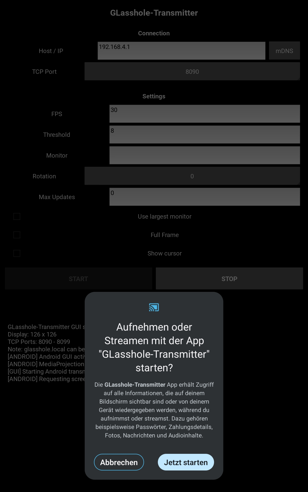

::: {align="center"}
# GLasshole Transmitter

### Send your desktop or Android screen to the LilyGO T-Glass

[← Back to the project homepage](../README.md)
:::

------------------------------------------------------------------------

The GLasshole Transmitter captures your screen and streams it to a
T-Glass over your local Wi-Fi network. The same application workflow is
used on desktop and Android, with a small additional screen-capture
permission step on Android.

## Contents

-   [Starting the application](#starting-the-application)
-   [Connecting to the T-Glass](#connecting-to-the-t-glass)
-   [Application settings](#application-settings)
-   [Android installation](#android-installation)
-   [Starting an Android stream](#starting-an-android-stream)
-   [Troubleshooting](#troubleshooting)

## Starting the application

Use the prebuilt application for your platform:

  Platform   Start
  ---------- ------------------------------------------
  Linux      Run the `GLasshole` executable.
  Windows    Run `GLasshole.exe`.
  Android    Install and open `GLasshole_V1.0.2.apk`.

On Linux, make the file executable if necessary:

``` bash
chmod +x GLasshole
./GLasshole
```

Keep the transmitter and T-Glass connected to the same Wi-Fi network,
unless your network setup provides routing between them.

## Connecting to the T-Glass

In the **Connection** section:

1.  Enter the T-Glass IP address in **Host / IP**, or press **mDNS** to
    discover the device automatically. mDNS discovery is the recommended
    option when available.
2.  Select the TCP port configured on the T-Glass.
3.  Press **START** to begin streaming.
4.  Press **STOP** to end the stream.

The default TCP port is **8090**. The T-Glass can use ports
**8090--8099**; the selected port in the application must match the port
currently active on the T-Glass.

> **Important:** Do not use the same TCP port on multiple T-Glass
> devices on the same network. Use the physical button on each T-Glass
> to cycle its listening port.

## Application settings

The application provides the following capture and display options:

  -----------------------------------------------------------------------
  Setting                             Description
  ----------------------------------- -----------------------------------
  **FPS**                             Target capture/stream frame rate.
                                      The displayed default is 30 FPS.

  **Threshold**                       Change threshold used to decide
                                      when screen areas need updating.
                                      The displayed default is 8.

  **Monitor**                         Select the screen to capture when
                                      more than one monitor is available.

  **Rotation**                        Rotate the captured image to match
                                      the T-Glass viewing orientation.

  **Max Updates**                     Limit the number of updates sent.
                                      `0` is shown as the default.

  **Use largest monitor**             Automatically use the largest
                                      available monitor.

  **Full Frame**                      Send complete frames rather than
                                      relying only on changed areas.

  **Show cursor**                     Include the mouse pointer in the
                                      captured image.
  -----------------------------------------------------------------------

The best values depend on your display, computer and network. Start with
the defaults and adjust only if needed.

## Android installation

Install the APK manually:

1.  Copy `GLasshole_V1.0.2.apk` to your Android device.
2.  Open the APK using a file manager and start the installation.
3.  Android may show a **Google Play Protect** warning because the app
    is not recognised by Play Protect.
4.  Only proceed if the APK comes from a source you trust. In the
    warning shown below, the option is labelled **Install without scan**
    (German: *Ohne Scan installieren*).
5.  Complete the installation and open **GLasshole-Transmitter**.


*The screenshot shows the Play Protect prompt during manual
installation. The wording and appearance may differ between Android
versions.*

## Starting an Android stream

1.  Open GLasshole Transmitter.
2.  Enter the T-Glass IP address or tap **mDNS**.
3.  Select the matching TCP port.
4.  Tap **START**.
5.  Android displays a system confirmation asking whether GLasshole
    Transmitter may capture or stream what is shown on the screen.
6.  Tap **Start now** to grant screen-capture permission and begin
    streaming.



Android requires this confirmation as a security feature. You may need
to approve it again when starting a new screen-capture session.

## Troubleshooting

-   **The T-Glass is not discovered:** Check that both devices are on
    the same network and that mDNS is supported by the network. Enter
    the T-Glass IP address manually if necessary.
-   **No image appears:** Check that the selected TCP port matches the
    active port on the T-Glass. The default is `8090`.
-   **Several T-Glass devices are present:** Give each device a
    different listening port and select the corresponding port in the
    transmitter.
-   **Android shows no stream:** Make sure you tapped **Start now** in
    the Android screen-capture confirmation.

For T-Glass firmware flashing and Wi-Fi setup, return to the [main
project README](../README.md).
